# eBPFsentinel

<p align="center">
  <picture>
    <source media="(prefers-color-scheme: dark)" srcset="./assets/ebpfsentinel-lockup-dark.svg">
    
  </picture>
</p>

<p align="center">
  <b>Network and host security for every Linux node, in one rootless eBPF agent.</b><br>
  Firewall · IDS/IPS · DDoS · DLP inside TLS · threat intel · NAT · load balancing · QoS<br>
  workload firewall · process, file and mass-encryption detection · packet trace · flow export<br>
  <i>Free and open source, decided in the kernel.</i>
</p>

<p align="center">
  <a href="LICENSE"></a>
  
  
  <a href="https://docs.ebpfsentinel.io"></a>
</p>

eBPFsentinel is a network and host security agent for Linux, written in Rust. It
ships 31 eBPF programs for XDP, TC, cgroup, LSM, tracepoint and uprobe hooks and
takes its verdicts there: an unwanted packet is dropped in the network driver
before the kernel has allocated anything for it, a TLS payload is read in the
application's own library without a proxy or a key, and a process is named,
followed and stopped from the kernel. About **1.2 to 1.9 µs of kernel time per
packet** on the full receive path, every feature on: 1848, 1360 and 1238 ns per
packet at 25 kpps, 50 kpps and the highest rate in the 2026-11-08 run
([benchmark results](tests/perf/BENCHMARK-RESULTS.md#what-verifying-the-rule-scans-once-costs-a-packet)).

## Why eBPFsentinel

- **One agent, not a stack.** Firewall, IDS/IPS, DDoS, DLP, threat intel, NAT, QoS and host detection share one kernel pipeline and one configuration, instead of a rack of appliances or a pile of daemons each with its own parser and its own copy of the packet. Less to deploy, less to patch, less attack surface.
- **The verdict at the driver.** Unwanted traffic dies at XDP, before a socket, a copy or a context switch exists for it. What passes is inspected at TC without leaving the kernel: no sidecar hop, no packet copied to userspace on the fast path.
- **Network and host, from one vantage point.** One agent per node sees east-west and north-south traffic, and also the process behind each flow, the files it changes and the executables allowed to reach the network. No per-app instrumentation, no sidecar per workload.
- **Rootless by construction.** The agent loads its programs through a BPF token and holds zero `CAP_BPF` / `CAP_NET_ADMIN`; a small broker, the warden, keeps the few operations the kernel will not delegate. The domain, ports, application and agent crates are `#![forbid(unsafe_code)]`, and every alert carries its MITRE ATT&CK technique.
- **Free, with its limits stated.** Every engine below is in this repository under AGPL-3.0, on as many hosts as you like. A few stop at a stated ceiling (three automatic response policies, one alert-triggered capture of 60 s, DLP in alert mode on the built-in card, national identifier and credential patterns, three fixed roles); the [commercial layer](#oss-vs-enterprise) lifts them and adds fleet, investigation and compliance on top.

## What it does

A snapshot of the capabilities below - see the [Features guide](https://docs.ebpfsentinel.io/features/overview) for the full reference on each engine.

### Network Security & Control

| Feature | Summary |
|---------|---------|
| **DDoS Mitigation** | XDP-speed SYN cookies + SYN/ICMP/UDP flood detection, drops attacks before the TCP stack |
| **Stateful Firewall** | L3/L4 filtering with conntrack, GeoIP, zones, scheduling, shadow rules, VLAN/QinQ, IPv4/IPv6 |
| **Workload Firewall** | Rules naming an executable, a systemd unit, a cgroup or a container, decided at `connect()`, `sendmsg()` and `bind()`, with destinations by name or by remote workload |
| **Executables Allowed on the Network** | Only listed executables open internet sockets, decided in the kernel from the calling task. Needs the BPF LSM active at boot (`lsm=` including `bpf`), which not every distribution or host provider sets: `ebpfsentinel-agent ebpf host-check` answers for your own host in one line, as any user with no agent running, and names the `lsm=` value to set; a running agent reports the same in `/api/v1/ebpf/kernel-features`. Without it an observing list is skipped and an enforcing one refuses to start the agent |
| **Kubernetes NetworkPolicy** | The agent watches the standard `networking.k8s.io/v1` `NetworkPolicy`, `Pod`, `Namespace`, `Service` and `EndpointSlice` objects itself and enforces them on its node's pods through cgroup hooks, where the CNI leaves them unenforced (Flannel, kubenet). No CRD and no operator. Off by default: `container.kubernetes.enabled` plus `network_policy.mode: observe` counts what would be refused, `enforce` refuses it (chart value `container.kubernetes.networkPolicy.mode`). The chart does not check whether the CNI already enforces; the operator adds that check and translates `CiliumNetworkPolicy`. See [network policy](https://docs.ebpfsentinel.io/features/network-policy) |
| **Cluster IP at connect()** | An opted-in pod's connection to a Service address sent straight to a ready backend, without kube-proxy's NAT |
| **L7 Filtering** | Protocol-aware rules for HTTP, TLS/SNI, gRPC, SMTP, FTP, SMB |
| **L4 Load Balancer** | TCP/UDP/TLS passthrough with five algorithms: round-robin, weighted, ip-hash, least-conn, maglev |
| **Traffic Shaping (QoS)** | Bandwidth limits, ECN marking, EDT pacing, delay/loss emulation, per-cgroup egress ceilings |
| **Rate Limiting** | Four algorithms with kernel-side per-country tiers |
| **NAT** | SNAT, DNAT, masquerade, port forwarding, 1:1, NPTv6, hairpin |
| **Connection Tracking** | Kernel-side TCP/UDP/ICMP state machine with timeout policies |
| **Traffic Normalization** | TTL/MSS/flag scrubbing, IP ID randomization, DSCP rewriting |
| **Policy Routing** | Multi-gateway with health checks and automatic failover |
| **Zone Segmentation** | Network zones (DMZ/LAN/WAN) with inter-zone isolation |
| **Interface Groups** | Named NIC groups for multi-NIC rule scoping |
| **IP/Port Aliases** | Reusable named objects across firewall, IPS, and DDoS rules |
| **IPv6 Dual-Stack** | Full V4/V6 parity, NDP-aware, NPTv6 |

### Threat Detection & Response

| Feature | Summary |
|---------|---------|
| **IDS / IPS** | Kernel-side pattern matching with automatic blocking |
| **Threat Intelligence** | Feeds fetched by URL (STIX 2.1 bundles, CSV, JSON, plain lists) and a CrowdSec local API, matched in real time on addresses, domains and URLs. Pulling from a MISP or TAXII server is in the Enterprise tier |
| **DLP** | Built-in PCI, PII and credential patterns on TLS plaintext, read by a uprobe in the process's shared OpenSSL or BoringSSL library, detect and alert. Custom patterns and blocking are in the paid tiers from Professional, Go, Java and statically linked TLS from Enterprise |
| **DNS Security** | Passive capture, blocklists, behavioral reputation scoring, DoH/DoT detection |
| **Host Rules** | Rules written as intentions (`process.connects`, `file.changes`, `bpf.foreign_program`), each served by whichever hook the host's kernel offers, in shadow before they alert |
| **Process Table** | Every fork, exec and exit, with the container and the chain of ancestors, so a pid becomes a name |
| **Process Detections** | Reverse shells, binaries with no file on disk, and a server's unexpected descendant, read off the process tree where it holds a connection |
| **File Watch** | Every change on whole filesystems with the process that made it, baselines of content, mode, owner and extended attributes, alerts on watched paths and on the agent's own files. Detection only: nothing is blocked |
| **Mass Encryption** | One run encrypting many files, recognised by signals that agree, and with the stop on the whole run killed, workers included, its files counted in the alert. Detected and stopped, not prevented and not undone: the files written before the verdict are lost and nothing is rolled back |
| **Network Inventory** | Packet sockets and their filters, listening sockets and who bound them, foreign eBPF programs on the network path, each new one an alert; ports a bind finds held and no listing shows, processes a signal reaches and `/proc` does not list |
| **Installed Packages** | What the dpkg, rpm and Alpine databases say is installed, in the host's root and every container's, read without running a package manager. A list, not a vulnerability verdict |
| **Self-Protection** | No other process detaches the agent's links or writes its maps. Needs the BPF LSM active at boot, like the executables list |
| **Learning Mode** | A declared window of what each workload dialled, rendered back as workload firewall rules in observe mode |
| **MITRE ATT&CK Mapping** | Every alert tagged with tactic + technique ID |
| **JA4 Fingerprinting** | TLS client fingerprinting for C2 and malware detection, following the JA4 method by FoxIO (BSD 3-Clause) |
| **Network Cryptography** | Which flows negotiate a post-quantum hybrid, a classical curve or less than TLS 1.2, read off the handshakes without decrypting |
| **GeoIP Enforcement** | MaxMind country resolution shared across all engines |
| **Automated Response** | Time-bounded block and throttle, manual or on up to three policies matching severity and component, expiring on their own. MITRE conditions, flow isolation, cooldowns and unlimited policies are in the Enterprise tier |

### Operations

| Feature | Summary |
|---------|---------|
| **Container Awareness** | Every event named with its container and pod: Docker, Podman, containerd, CRI-O, LXC, Kubernetes |
| **Packet Trace** | One crafted packet run through the loaded programs, each saying what it decided and which rule decided it |
| **Kernel Drop Reasons** | Every packet the kernel drops, counted by its reason and interface |
| **TCP Health Per Edge** | Retransmissions, resets and failed connections counted per pair of services |
| **Flow Export** | Connection table as IPFIX, OTLP logs, syslog, CEF or JSON lines |
| **Hot Reload** | Update rules and toggle eBPF programs without restart |
| **REST API** | OpenAPI 3.1 with Swagger UI, all domains covered |
| **gRPC Streaming** | Real-time alert subscriptions with severity/component filters |
| **Prometheus Metrics** | Per-domain and kernel-side eBPF counters |
| **OTLP Export** | Alerts as OpenTelemetry Logs (gRPC or HTTP) |
| **Alert Pipeline** | Routing to email, webhook, log, OTLP with dedup + throttling |
| **Audit Trail** | Rule change history with before/after diff and actor tracking |
| **Packet Capture** | libpcap capture with BPF filters, manual or triggered by an alert, one capture at a time, 60 s when an alert starts it. Concurrent captures and the forensics API are in the Enterprise tier |
| **CLI** | Forty-seven subcommands with `--output table\|json` and `--token` auth, every API route reachable |
| **Authentication** | JWT, OIDC, and API keys, with three fixed roles (admin, operator, viewer). Custom roles are in the paid tiers from Professional |
| **TLS 1.3** | rustls + aws_lc_rs, post-quantum hybrid key exchange (X25519MLKEM768) |

## Architecture

<p align="center">
  <picture>
    <source media="(prefers-color-scheme: dark)" srcset="./assets/ebpfsentinel-datapath-dark.svg">
    
  </picture>
</p>

<details>
<summary><b>Every program and every tail call</b></summary>



</details>

```mermaid
flowchart TB
    subgraph kernel["Linux Kernel (31 eBPF programs)"]
        direction TB
        subgraph xdp["XDP - first hook on the receive path"]
            fw["xdp-firewall\n(stateful L3/L4)"]
            fw_rej["xdp-firewall-reject\n(TCP RST / ICMP)"]
            rl["xdp-ratelimit\n(DDoS / rate limit)"]
            rl_sc["xdp-ratelimit-syncookie\n(SYN cookie forge)"]
            lb["xdp-loadbalancer\n(L4 DNAT)"]
            vip["xdp-vip-announcer\n(VIP ARP reply)"]
            pass["xdp-pass\n(veth peer · test rig)"]
        end
        subgraph tc["TC - deep packet inspection & rewriting"]
            ct[tc-conntrack]
            scrub[tc-scrub]
            nat_i[tc-nat-ingress]
            nat_e[tc-nat-egress]
            ids[tc-ids]
            ti[tc-threatintel]
            dns[tc-dns]
            qos[tc-qos]
        end
        uprobe["uprobe-dlp\n(SSL/TLS intercept)"]
        crypto["uprobe-crypto\n(crypto library calls, counted)"]
        drops["tracepoint-drop-reason\n(why the kernel dropped a packet)"]
        tcphealth["tracepoint-tcp-health\n(retransmits and resets per edge)"]
        subgraph off_wire["Off the wire - who, not what"]
            attr["cgroup-attribution\n(connect/bind/sendmsg + sock_ops)"]
            wl["cgroup-workload-firewall\n(connect/sendmsg/bind verdict)"]
            proc["tracepoint-process\n(execve / exit)"]
            sig["tracepoint-signal\n(stop an armed process)"]
            lsm["lsm-exec-network\n(listed executables only)"]
            digest["lsm-exec-digest\n(executable SHA-256 from IMA at exec)"]
            guard["lsm-bpf-guard\n(the agent's maps and links are its own)"]
            loadguard["lsm-bpf-load-guard\n(warden-loaded: a token load passes only signed)"]
            tamper["lsm-tamper-guard\n(no unsigned stop, trace or unpin; licensed)"]
            wref["lsm-write-refusal\n(a writer past a count under watched directories)"]
            redir["cgroup-connect-redirect\n(selected workloads to the TLS proxy)"]
            cip["cgroup-clusterip\n(opted-in workloads' cluster addresses at connect)"]
        end
    end

    packets(("Packets")) --> fw

    fw -- "PASS → slot 0" --> rl
    fw -- "REJECT → slot 1" --> fw_rej
    fw -- "PASS (no RL) → slot 2" --> lb
    fw -- "ARP VIP → slot 3" --> vip
    rl -- "SYN flood → slot 0" --> rl_sc
    rl -- "PASS → slot 1" --> lb
    fw_rej -- "XDP_TX" --> packets
    rl_sc -- "XDP_TX" --> packets
    lb -- "XDP_TX / REDIRECT" --> packets
    vip -- "XDP_TX" --> packets

    fw -- "XDP_PASS" --> tc
    tc --- uprobe
    attr -. "socket cookie, five-tuple" .-> uprobe

    subgraph agent["Userspace Agent (Rust)"]
        direction LR
        subgraph domain["Domain Engines"]
            de["Pure business logic\n(zero deps)"]
        end
        subgraph app["Application Services"]
            as["Use cases\n& orchestration"]
        end
        subgraph adapters["Adapters"]
            ebpf_a["eBPF maps\n& events"]
            http["REST API\n(Axum)"]
            grpc["gRPC\n(tonic)"]
            store["Storage\n(redb)"]
            otlp["OTLP exporter\n(alerts as logs)"]
        end
    end

    xdp -- "RingBuf / Maps" --> ebpf_a
    tc -- "RingBuf / Maps" --> ebpf_a
    uprobe -- "RingBuf" --> ebpf_a
    crypto -- "Maps" --> ebpf_a

    ebpf_a --> as
    as --> de
    http --> as
    grpc --> as
    store --> as

    cli(("CLI")) --> http
    swagger(("Swagger UI")) --> http
    prom(("Prometheus")) --> http
    alerts(("Alert clients")) --> grpc
    as --> otlp
    otlp --> otel(("OTLP collector"))
```

## Quick start

### See it work first, in one command

Before installing anything on a host you care about, run the lab. It builds a
network of its own on a bridge named `esdemo0`, touches no uplink of yours,
asks nothing of you and signs you up to nothing. It comes from the release,
like every other artifact:

```bash
curl -fsSLO https://github.com/ebpfsentinel/ebpfsentinel-release/releases/latest/download/ebpfsentinel-demo.tar.gz
tar xzf ebpfsentinel-demo.tar.gz && cd ebpfsentinel-demo
sudo ./demo.sh up
sudo ./demo.sh agent status
sudo ./demo.sh down
```

The lab is pinned to the release it was downloaded with, and its checksum and
signature are in that release's `ebpfsentinel-SHA256SUMS`. From a checkout of this
repository the same lab is `demo/`, and `sudo ./demo.sh up --local` builds the
agent from your working tree instead of pulling the published image.

What it shows, with the commands in the
[tutorials](https://docs.ebpfsentinel.io/tutorials):
a SYN flood stopped and its source blocked, a card number caught inside TLS
without a proxy and without a key, and a workload cut off for calling an AI
provider. `demo/gitops/gitops.sh up` runs the same agent as a fleet driven by
Argo CD, where a rule arrives through a commit and leaves through a revert.
Details, host requirements and the lab's own addresses are in
[`demo/README.md`](demo/README.md).

### Install for real

**Requirements:** Linux kernel 6.18+ on x86_64 or aarch64, with BTF (`CONFIG_DEBUG_INFO_BTF=y`). The floor is the first release that verifies a signed BPF program, and the kernel of Ubuntu 26.04, Ubuntu 24.04 HWE, Talos 1.12, EKS AL2023, GKE COS 133 and the AKS Ubuntu 26.04 node image; **BPF token delegation** is what lets the agent load its eBPF programs with zero `CAP_BPF` / `CAP_NET_ADMIN` (rootless).

Pick the path that matches the host. The first four install signed release artifacts, and all five run the same two processes: the rootless agent and the warden broker.

<details>
<summary><b>Debian, Ubuntu, Fedora, RHEL - package repository</b></summary>

The shortest path onto a Linux host, and the one that upgrades and removes
through the mechanism the host already runs. The packages are release
artifacts, built for amd64 and arm64 and covered by the release's signed
`ebpfsentinel-SHA256SUMS`.

```bash
# Debian, Ubuntu
sudo install -d -m 0755 /etc/apt/keyrings
curl -fsSL https://ebpfsentinel.github.io/ebpfsentinel-release/ebpfsentinel.gpg \
  | sudo tee /etc/apt/keyrings/ebpfsentinel.gpg > /dev/null
echo "deb [signed-by=/etc/apt/keyrings/ebpfsentinel.gpg] https://ebpfsentinel.github.io/ebpfsentinel-release/apt stable main" \
  | sudo tee /etc/apt/sources.list.d/ebpfsentinel.list
sudo apt-get update && sudo apt-get install ebpfsentinel

# Fedora, RHEL and derivatives
sudo rpm --import https://ebpfsentinel.github.io/ebpfsentinel-release/ebpfsentinel.asc
sudo curl -fsSL -o /etc/yum.repos.d/ebpfsentinel.repo \
  https://ebpfsentinel.github.io/ebpfsentinel-release/ebpfsentinel.repo
sudo dnf install ebpfsentinel
```

Installing starts nothing: the shipped configuration cannot guess which
interfaces to watch. Three host profiles ship beside it - a home router, a k3s
node, a Proxmox host - and the first start is a copy and two edits:

```bash
sudo cp /usr/share/ebpfsentinel/profiles/home-router.yaml /etc/ebpfsentinel/config.yaml
sudo $EDITOR /etc/ebpfsentinel/config.yaml      # the interface names
sudo systemctl enable --now ebpfsentinel-warden ebpfsentinel
```

Removing is `apt-get remove` or `dnf remove`, `apt-get purge` to drop the
configuration and the state with it. Either way both units are stopped and the
eBPF programs are detached from every interface. A single `.deb` or `.rpm`
verified against the release signing identity, the installed paths, the
upgrade behaviour and the NixOS module are in the
[packages guide](https://docs.ebpfsentinel.io/operations/deployment/packages).

</details>

<details>
<summary><b>Docker Compose - rootless agent and warden</b></summary>

The agent loads eBPF **exclusively** through a BPF token - never `CAP_BPF`, never `--privileged`. The deployment is two containers: the privileged `warden` broker and the rootless `agent`, sharing a control socket. `docker compose up` wires both:

```bash
REL=<release>      # the release tag, without its v
VER=<version>      # the agent's own version, named in that release's notes
ARCH=amd64         # or arm64
BASE=https://github.com/ebpfsentinel/ebpfsentinel-release/releases/download/v$REL
mkdir ebpfsentinel && cd ebpfsentinel
for f in compose.yaml ebpfsentinel-agent.json "ebpfsentinel-${VER}-linux-${ARCH}.tar.gz" \
         ebpfsentinel-SHA256SUMS{,.sig,.crt}; do
  curl -fsSLO "$BASE/$f"
done
# Verify ebpfsentinel-SHA256SUMS with cosign as in the tarball section below, then:
sha256sum --ignore-missing -c ebpfsentinel-SHA256SUMS

# The compose file mounts ./ebpfsentinel.yaml: take the reference configuration
# (or one of the profiles beside it) out of the release tarball, name your
# interfaces in it, and give it to the agent's uid, which rejects a
# world-readable file:
tar xzf "ebpfsentinel-${VER}-linux-${ARCH}.tar.gz" --strip-components=1 \
  "ebpfsentinel-${VER}-linux-${ARCH}/ebpfsentinel.yaml"
$EDITOR ebpfsentinel.yaml                    # agent.interfaces
sudo chown 65534:65534 ebpfsentinel.yaml && sudo chmod 640 ebpfsentinel.yaml

docker compose up -d        # starts the warden broker + the agent
docker compose logs -f
```

The compose file of a release names that release's images, so upgrading is
fetching the next release's `compose.yaml` and seccomp profile; the
configuration stays yours, and no checkout is involved.

The capabilities are held by the `warden` broker (bpffs delegation, conntrack/routes, the pcap pool + ARP); the agent drops every capability - it self-unshares a user namespace and loads its own eBPF through the token. See the [BPF token guide](https://docs.ebpfsentinel.io/operations/deployment/bpf-token) for the systemd and Kubernetes paths and the full capability matrix.

</details>

<details>
<summary><b>Kubernetes - Helm chart</b></summary>

The chart is published as an OCI artifact beside the images of each release,
and needs Kubernetes 1.30 or later. It runs the warden and the agent as two
containers of one DaemonSet pod, sharing the broker socket:

```bash
helm install ebpfsentinel oci://ghcr.io/ebpfsentinel/charts/ebpfsentinel \
  --version <version> \
  --namespace ebpfsentinel --create-namespace \
  --set agent.interfaces='{eth0}'
```

`agent.interfaces` names the node's own interfaces, since the pod runs on the
host network. Values, upgrades, admission policies and the CNI coexistence
matrix are in the
[Kubernetes guide](https://docs.ebpfsentinel.io/operations/deployment/kubernetes).

</details>

<details>
<summary><b>Any Linux host - signed tarball</b></summary>

For a host that carries no third-party repository. Every artifact comes from
the [release](https://github.com/ebpfsentinel/ebpfsentinel-release/releases),
which also says which operator and dashboard versions it was tested with. The
tarball ships the agent, the warden, prebuilt eBPF objects, both systemd units,
the profiles and an `install.sh`:

```bash
REL=<release>      # the release tag, without its v
VER=<version>      # the agent's own version, named in that release's notes
BASE=https://github.com/ebpfsentinel/ebpfsentinel-release/releases/download/v$REL
curl -fsSLO "$BASE/ebpfsentinel-${VER}-linux-amd64.tar.gz"
curl -fsSLO "$BASE/ebpfsentinel-SHA256SUMS"
curl -fsSLO "$BASE/ebpfsentinel-SHA256SUMS.sig"
curl -fsSLO "$BASE/ebpfsentinel-SHA256SUMS.crt"

cosign verify-blob \
  --certificate ebpfsentinel-SHA256SUMS.crt \
  --signature ebpfsentinel-SHA256SUMS.sig \
  --certificate-oidc-issuer https://token.actions.githubusercontent.com \
  --certificate-identity-regexp '^https://github\.com/ebpfsentinel/ebpfsentinel-release/\.github/workflows/sign-blob\.yml@refs/tags/v.*$' \
  --certificate-github-workflow-repository ebpfsentinel/ebpfsentinel-release \
  ebpfsentinel-SHA256SUMS
sha256sum --ignore-missing -c ebpfsentinel-SHA256SUMS

tar xzf "ebpfsentinel-${VER}-linux-amd64.tar.gz"
cd "ebpfsentinel-${VER}-linux-amd64"
sudo ./install.sh            # installs to /usr/local, wires up both systemd units
```

`cosign verify-blob` says the checksum file came from this project's release
workflow at a tag; `sha256sum -c` says the file on disk is the one it names.
`sudo /usr/local/share/ebpfsentinel/uninstall.sh [--purge]` reverses the
install. Each release also carries a dual-signed inventory of every binary hash
and image digest, checkable with `policy/verify.sh` from the same release.

</details>

<details>
<summary><b>Build from source - contributors</b></summary>

For contributors and for reading the code. A local build produces eBPF objects nobody signed, so it is not what a published install path uses.

The userspace agent builds on **stable**; the eBPF kernel programs need a **nightly** toolchain, pinned to a date in `crates/ebpf-programs/rust-toolchain.toml` and passed to cargo by `cargo xtask` (`bpfel` target). Install Rust via [rustup](https://rustup.rs):

```bash
cargo build --release        # agent + warden broker (stable)
cargo xtask ebpf-build        # eBPF programs (the pinned nightly)

# eBPF loads only through a BPF token (a user-namespace feature). The privileged
# `warden` broker (bpffs delegation, conntrack, routes, ARP, pcap) runs alongside
# the agent, which self-unshares a user namespace and loads its own eBPF through
# the token - never CAP_BPF, never as root: started as root it drops to 65534
# first, the uid the broker serves by default. Start the broker, then the agent
# in a mount namespace with a tmpfs on /sys/fs/bpf, where it creates the
# directory the delegated bpffs is mounted on. The broker answers only what the
# configuration uses, written by the agent binary before it starts:
sudo chown 65534 config/ebpfsentinel.yaml && sudo chmod 640 config/ebpfsentinel.yaml
sudo mkdir -p /run/ebpfsentinel
sudo ./target/release/ebpfsentinel-agent --config config/ebpfsentinel.yaml warden-policy \
  --output-file /run/ebpfsentinel/warden-policy.json
sudo ./target/release/warden serve /run/ebpfsentinel/warden.sock \
  --policy /run/ebpfsentinel/warden-policy.json &
sudo unshare --mount --propagation private sh -c \
  'mount -t tmpfs -o mode=1777 tmpfs /sys/fs/bpf && exec "$@"' sh \
  env EBPFSENTINEL_WARDEN_SOCK=/run/ebpfsentinel/warden.sock \
  ./target/release/ebpfsentinel-agent --config config/ebpfsentinel.yaml
```

The systemd install (`dist/install.sh`) wires this as two units - `ebpfsentinel-warden.service` (broker) + `ebpfsentinel.service` (agent, as its own `ebpfsentinel` user) - mirroring the Docker split.

</details>

### Minimal config

Only the interface is required:

```yaml
agent:
  interfaces: [eth0]
```

### Verify it's running

```bash
curl http://127.0.0.1:8080/healthz     # liveness probe, answers without a key
```

Every other route authenticates. With no method configured, the agent drew a
key at first start, logged it once and kept it in its state directory, which is
somewhere else on each install path:

```bash
# Package, tarball or source build: the state directory is on the host
export EBPFSENTINEL_TOKEN=$(sudo cat /var/lib/ebpfsentinel/auth/api-key)

# Docker Compose: the state directory is the ebpfsentinel-state volume
export EBPFSENTINEL_TOKEN=$(sudo cat "$(docker volume inspect -f '{{.Mountpoint}}' ebpfsentinel_ebpfsentinel-state)/auth/api-key")

# Helm, with no auth.existingSecret: each node keeps its own key, at
# /var/lib/ebpfsentinel/k8s/<namespace>/<release>/auth/api-key on the node, and
# the agent logged it at first start
kubectl -n ebpfsentinel logs ds/ebpfsentinel -c agent | grep "API key was generated"
# Helm, with auth.existingSecret: the key is that Secret's
export EBPFSENTINEL_TOKEN=$(kubectl -n ebpfsentinel get secret <secret> -o jsonpath='{.data.api-key}' | base64 -d)
```

```bash
ebpfsentinel-agent status              # agent + per-engine status, reads the variable
curl -H "X-API-Key: $EBPFSENTINEL_TOKEN" http://127.0.0.1:8080/api/v1/firewall/rules
```

Run beside the agent, the command line finds the key by itself:
`docker compose exec agent ebpfsentinel-agent status` and
`kubectl -n ebpfsentinel exec ds/ebpfsentinel -c agent -- ebpfsentinel-agent status`
need no variable.

The control plane is shut by default: it authenticates, and it stays on
loopback unless TLS is configured. Both are one setting away from being opened
deliberately, and neither can be opened by accident.

See the [Getting Started guide](https://docs.ebpfsentinel.io/getting-started/quickstart) for detailed setup instructions.

## Documentation

Full documentation is at [docs.ebpfsentinel.io](https://docs.ebpfsentinel.io):

| Section | Description |
| ------- | ----------- |
| [Getting Started](https://docs.ebpfsentinel.io/getting-started/quickstart) | Installation, prerequisites, first run |
| [Features](https://docs.ebpfsentinel.io/features/overview) | Detailed feature guides (firewall, IDS, DLP, ...) |
| [Configuration](https://docs.ebpfsentinel.io/configuration/overview) | YAML reference for all sections |
| [Architecture](https://docs.ebpfsentinel.io/architecture/overview) | Hexagonal/DDD design, eBPF pipeline, data flow |
| [Kernel Reference](https://docs.ebpfsentinel.io/kernel/overview) | eBPF programs, maps, helpers, pipeline |
| [Hot Reload](https://docs.ebpfsentinel.io/operations/hot-reload) | Dynamic eBPF program loading/unloading |
| [REST API](https://docs.ebpfsentinel.io/api-reference/rest-api) | All endpoints with request/response formats |
| [gRPC API](https://docs.ebpfsentinel.io/api-reference/grpc-api) | Alert streaming service |
| [CLI Reference](https://docs.ebpfsentinel.io/cli-reference/) | All commands and options |
| [Prometheus Metrics](https://docs.ebpfsentinel.io/api-reference/prometheus-metrics) | Metric names and labels |
| [Deployment](https://docs.ebpfsentinel.io/operations/deployment/docker) | Docker, Kubernetes, binary |
| [Security](https://docs.ebpfsentinel.io/architecture/security-model) | TLS, auth, hardening |
| [Development](https://docs.ebpfsentinel.io/development/building) | Building, testing, contributing |
| [Examples](https://docs.ebpfsentinel.io/examples/) | Real-world deployment scenarios |

Per-feature configuration examples are in [`config/examples/`](config/examples/).

The changelog is kept with the releases rather than here, so the whole product's history reads in one place: [`ebpfsentinel-release/changelogs/ebpfsentinel.md`](https://github.com/ebpfsentinel/ebpfsentinel-release/blob/main/changelogs/ebpfsentinel.md).

## Compatibility

Linux only, kernel **6.18 or later with BTF** (`/sys/kernel/btf/vmlinux`), on x86_64 and aarch64 (the userspace tests run on both in CI). What matters is the running kernel, not the release.

| Distribution | Kernel it ships | Supported |
|---|---|---|
| Ubuntu 26.04 LTS | 7.0 | Yes |
| Ubuntu 24.04 LTS | 6.8 (GA), 7.0 (HWE since 24.04.5) | With the HWE kernel (`linux-generic-hwe-24.04`) |
| Ubuntu 22.04 | 5.15, HWE stops at 6.8 | No |
| Debian 13 | 6.12, 6.18 and later in trixie-backports | With the backports kernel |
| Debian 12 | 6.1 | No |
| Fedora 43+ | 6.19 and later | Yes |
| openSUSE Tumbleweed | rolling | Yes |
| SLES 16 / openSUSE Leap 16 | 6.12 | No |
| RHEL / Rocky / AlmaLinux 10 and 9 | 6.12 / 5.14 for the release's life | No |
| Alpine 3.23+ | 6.18 (`linux-lts`) | Yes |
| Alpine 3.22 and earlier | 6.12 or older | No |
| Arch Linux | rolling | Yes |
| NixOS 26.05+ | 6.18 | Yes (25.11 with `linuxPackages_6_18`) |
| Talos 1.12+ | 6.18 | Yes |
| Flatcar | 6.18 in the releases of 2026 | On a release that runs 6.18 (`uname -r`) |

Managed Kubernetes, where the node kernel is the provider's choice:

| Service | Node image | Kernel | Supported |
|---|---|---|---|
| EKS | Amazon Linux 2023 on kernel 6.18 (the AL2023 default since 2026-08-17) | 6.18 | Yes |
| EKS | Amazon Linux 2023 on kernel 6.1 or 6.12 | 6.1 / 6.12 | No |
| EKS | Bottlerocket `k8s-1.36` and later, outside FIPS | 6.18 | Yes |
| EKS | Bottlerocket FIPS variants | 6.12 | No |
| GKE | Container-Optimized OS 133 and later | 6.18 | Yes |
| GKE | Container-Optimized OS 125 to 129 | 6.12 | No |
| AKS | Ubuntu 26.04 node image (Kubernetes 1.36 and later) | 7.0 | Yes |
| AKS | Ubuntu 24.04 node image, Azure Linux 3.0 | 6.8, 6.6 | No |
| Scaleway Kapsule | Ubuntu node image | not published | Check `uname -r` on a node |

The refusal of an unsigned load, the network executables list and the self-protection guard also need the BPF LSM, `bpf` in the LSMs the kernel starts with. Without `lsm=` on its command line a kernel starts the list it was built with, read for each image above in [`tests/integration/records/2026-11-23-bpf-lsm-by-distribution.md`](tests/integration/records/2026-11-23-bpf-lsm-by-distribution.md) by `tests/integration/scripts/lsm-defaults.py`:

| `bpf` at boot | Distributions and node images |
|---|---|
| Yes | Ubuntu 26.04 and 24.04 HWE (AKS included), Debian 13 backports, Fedora, openSUSE Tumbleweed, Arch Linux, NixOS 26.05, Talos, Amazon Linux 2023 and Bottlerocket on 6.18 (EKS) |
| No, add `bpf` to `lsm=` | Alpine `linux-lts`, Flatcar |
| Not measured | Container-Optimized OS (GKE): read `/sys/kernel/security/lsm` on a node |

A command line that sets `lsm=` overrides the list; `ebpfsentinel-agent ebpf host-check` answers for a running host.

| Runs as | How |
|---|---|
| Native package | `.deb` / `.rpm`, systemd units for the agent and the warden |
| Signed tarball | any Linux host, same systemd units |
| Docker Compose | rootless agent and privileged warden, `network_mode: host` |
| Kubernetes | DaemonSet from the Helm chart, warden as a native sidecar |
| NixOS | the module in `dist/nix` |

Every container gets its id and runtime from its cgroup path; the name, image and labels come from the enricher of its runtime.

| Container runtime on the host | Name, image, labels |
|---|---|
| Docker | Docker enricher |
| Podman, rootful and rootless | Podman enricher (socket), or the container store when no socket answers |
| containerd, CRI-O under Kubernetes | Kubernetes enricher (pod, namespace, labels) |
| containerd, CRI-O outside Kubernetes | id and runtime only |
| LXC, Incus, LXD, Proxmox CT | LXC enricher |

See [Compatibility](https://docs.ebpfsentinel.io/operations/compatibility) for the full matrix.

## OSS vs Enterprise

The **open-source agent** is complete on its own: every engine listed above, the
REST and gRPC APIs, the CLI, authentication and observability, on as many hosts
as you like, and nothing in it phones a licence server. A few engines stop at a
ceiling the agent states when a configuration crosses it: three automatic response
policies, one alert-triggered capture of at most 60 s, DLP in alert mode on its
built-in card, national identifier and credential patterns, and three fixed roles.
The paid tiers lift them, as the table says.

The **commercial layer** (`ebpfsentinel-enterprise`, the web console and the
Kubernetes operator) is for running a fleet, investigating across it and proving
it to an auditor. It comes in three tiers, each containing the one before it:

| | OSS | Professional | Enterprise | Critical |
| --- | :---: | :---: | :---: | :---: |
| *Built for* | *Anyone* | *A platform team on Kubernetes* | *A team running a SOC* | *Regulated estates, providers* |
| **Every engine of the agent**, unlimited hosts | Yes | Yes | Yes | Yes |
| Custom roles, DLP custom patterns and block mode (OSS: three fixed roles, alert mode on the built-in patterns) |  | Yes | Yes | Yes |
| Unlimited response policies, concurrent and ring-buffer captures (OSS: three policies, one 60 s capture) |  |  | Yes | Yes |
| Commercial licence instead of AGPL obligations |  | Yes | Yes | Yes |
| Web console: entity pages, process tree, fleet service map, rule replay |  | Yes | Yes | Yes |
| Kubernetes operator |  | Yes | Yes | Yes |
| Fleet inventory, drift and exposure across nodes |  | Yes | Yes | Yes |
| Advanced RBAC, offline licence activation |  | Yes | Yes | Yes |
| Advanced DLP (Vectorscan, custom patterns, block mode) |  | Yes | Yes | Yes |
| Application attack detection, per-protocol policies |  | Yes | Yes | Yes |
| Signed detection content, with a rollback |  | Yes | Yes | Yes |
| Scanner findings ranked by what the host runs and exposes |  | Yes | Yes | Yes |
| Compliance reports (PCI-DSS, HIPAA, GDPR, SOC 2, NIS2, DORA, SecNumCloud, HDS) |  | Yes | Yes | Yes |
| Bare-metal LoadBalancer over ARP or BGP |  | Yes | Yes | Yes |
| Cases, hunting, false-positive suppressions |  |  | Yes | Yes |
| SIEM connectors (10) and Sigma rules |  |  | Yes | Yes |
| TAXII 2.1 and MISP feeds, retroactive matching |  |  | Yes | Yes |
| ML anomaly detection with a signed base model |  |  | Yes | Yes |
| TLS intelligence and post-quantum readiness |  |  | Yes | Yes |
| Extended TLS libraries and L7 parsers |  |  | Yes | Yes |
| AI, LLM and MCP traffic security |  |  | Yes | Yes |
| Response orchestration, process response, workload quarantine |  |  | Yes | Yes |
| Tamper-protected agent, stopped only by a signed order |  |  | Yes | Yes |
| Network forensics and incident evidence pack |  |  | Yes | Yes |
| Multi-cluster federation |  |  | Yes | Yes |
| NIS2 and DORA notification drafts |  |  |  | Yes |
| Controls proven continuously, attested nodes, sealed audit record |  |  |  | Yes |
| High availability, active-active |  |  |  | Yes |
| Multi-tenancy for providers |  |  |  | Yes |
| Air-gapped deployment |  |  |  | Yes |

Prices are per node and published, and every paid tier is bought online:
[ebpfsentinel.io/pricing](https://ebpfsentinel.io/pricing). The row-by-row
matrix, with the licence feature behind each line, is at
[ebpfsentinel.io/compare](https://ebpfsentinel.io/compare), and each feature
has its page under
[Enterprise Features](https://docs.ebpfsentinel.io/features/enterprise/overview).

## License

GNU Affero General Public License v3.0 - see [LICENSE](LICENSE).

The agent attaches uprobes to system cryptographic libraries, reads package
databases and watches files through fanotify without linking any of them; how,
and what proves it, is in [LICENSING.md](LICENSING.md).
