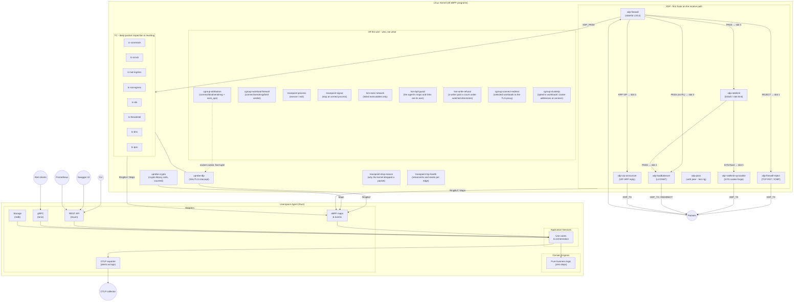

# eBPFsentinel

<p align="center">
  
</p>

A unified, kernel-native **Network & Security platform** for Linux - one Rust agent that replaces your firewall, IDS/IPS, DDoS mitigation, DLP, and 10+ more tools, all running in-kernel via eBPF at about a microsecond of kernel time per packet (see [benchmark results](tests/perf/BENCHMARK-RESULTS.md)). Not an endpoint agent - it enforces security inline, right where your traffic flows.

## Why eBPFsentinel

- **One agent, not a stack.** Firewall, IDS/IPS, DDoS, DLP, threat intel, NAT, and QoS normally mean a rack of appliances or a pile of daemons - each with its own config, parser, and packet copy. eBPFsentinel runs them as one agent sharing one kernel pipeline, beside a small privileged broker (the warden) that holds the few operations the kernel will not delegate: less to deploy, less to patch, less attack surface.
- **In-kernel, at the source.** Programs attach at XDP/TC/uprobe hook points, so traffic is inspected and dropped in the kernel - no packet copy to userspace on the fast path, no sidecar hop. Malicious traffic dies on the wire instead of costing you CPU upstack.
- **Network placement, not endpoint sprawl.** It runs where traffic flows - host NIC, node boundary - not as an agent on every workload. One enforcement point per node sees east-west and north-south alike, with no per-app instrumentation.
- **Built for trust.** Pure Rust with `#![forbid(unsafe_code)]` across the domain and application layers and a hexagonal/DDD design. The agent runs **rootless** via BPF token delegation - zero `CAP_BPF` / `CAP_NET_ADMIN` in the agent itself - and tags every alert with MITRE ATT&CK for your SIEM.

## What it does

A snapshot of the capabilities below - see the [Features guide](https://github.com/ebpfsentinel/ebpfsentinel-docs/tree/main/docs/features/overview.md) for the full reference on each engine.

### Network Security & Control

| Feature | Summary |
|---------|---------|
| **DDoS Mitigation** | XDP-speed SYN cookies + SYN/ICMP/UDP flood detection, drops attacks before the TCP stack |
| **Stateful Firewall** | L3/L4 filtering with conntrack, GeoIP, zones, scheduling, shadow rules, VLAN/QinQ, IPv4/IPv6 |
| **Workload Firewall** | Rules naming an executable, a systemd unit, a cgroup or a container, decided at `connect()`, `sendmsg()` and `bind()`, with destinations by name or by remote workload |
| **Executables Allowed on the Network** | Only listed executables open internet sockets, decided in the kernel from the calling task. Needs the BPF LSM active at boot (`lsm=` including `bpf`), which not every distribution or host provider sets: `/api/v1/ebpf/kernel-features` answers for your own host |
| **Kubernetes NetworkPolicy** | Enforces `NetworkPolicy` objects where the CNI leaves them unenforced (Flannel, kubenet) |
| **Cluster IP at connect()** | An opted-in pod's connection to a Service address sent straight to a ready backend, without kube-proxy's NAT |
| **L7 Filtering** | Protocol-aware rules for HTTP, TLS/SNI, gRPC, SMTP, FTP, SMB |
| **L4 Load Balancer** | TCP/UDP/TLS passthrough with five algorithms: round-robin, weighted, ip-hash, least-conn, maglev |
| **Traffic Shaping (QoS)** | Bandwidth limits, ECN marking, EDT pacing, delay/loss emulation, per-cgroup egress ceilings |
| **Rate Limiting** | Four algorithms with kernel-side per-country tiers |
| **NAT** | SNAT, DNAT, masquerade, port forwarding, 1:1, NPTv6, hairpin |
| **Connection Tracking** | Kernel-side TCP/UDP/ICMP state machine with timeout policies |
| **Traffic Normalization** | TTL/MSS/flag scrubbing, IP ID randomization, DSCP rewriting |
| **Policy Routing** | Multi-gateway with health checks and automatic failover |
| **Zone Segmentation** | Network zones (DMZ/LAN/WAN) with inter-zone isolation |
| **Interface Groups** | Named NIC groups for multi-NIC rule scoping |
| **IP/Port Aliases** | Reusable named objects across firewall, IPS, and DDoS rules |
| **IPv6 Dual-Stack** | Full V4/V6 parity, NDP-aware, NPTv6 |

### Threat Detection & Response

| Feature | Summary |
|---------|---------|
| **IDS / IPS** | Kernel-side pattern matching with automatic blocking |
| **Threat Intelligence** | Any OSINT feed (CSV, JSON, STIX 2.1) with real-time IOC matching on addresses, domains and URLs |
| **DLP** | TLS plaintext inspection for PCI, PII, and credential patterns via uprobe |
| **DNS Security** | Passive capture, blocklists, behavioral reputation scoring, DoH/DoT detection |
| **Host Rules** | Rules written as intentions (`process.connects`, `file.changes`, `bpf.foreign_program`), each served by whichever hook the host's kernel offers, in shadow before they alert |
| **Process Table** | Every fork, exec and exit, with the container and the chain of ancestors, so a pid becomes a name |
| **Process Detections** | Reverse shells, binaries with no file on disk, and a server's unexpected descendant, read off the process tree where it holds a connection |
| **File Watch** | Every change on whole filesystems with the process that made it, baselines of content, mode, owner and extended attributes, alerts on watched paths and on the agent's own files. Detection only: nothing is blocked |
| **Mass Encryption** | One run encrypting many files, recognised by signals that agree, and with the stop on the whole run killed, workers included, its files counted in the alert. Detected and stopped, not prevented and not undone: the files written before the verdict are lost and nothing is rolled back |
| **Network Inventory** | Packet sockets and their filters, listening sockets and who bound them, foreign eBPF programs on the network path, each new one an alert; ports a bind finds held and no listing shows, processes a signal reaches and `/proc` does not list |
| **Installed Packages** | What the dpkg, rpm and Alpine databases say is installed, in the host's root and every container's, read without running a package manager. A list, not a vulnerability verdict |
| **Self-Protection** | No other process detaches the agent's links or writes its maps. Needs the BPF LSM active at boot, like the executables list |
| **Learning Mode** | A declared window of what each workload dialled, rendered back as workload firewall rules in observe mode |
| **MITRE ATT&CK Mapping** | Every alert tagged with tactic + technique ID |
| **JA4+ Fingerprinting** | TLS client fingerprinting for C2 and malware detection |
| **Network Cryptography** | Which flows negotiate a post-quantum hybrid, a classical curve or less than TLS 1.2, read off the handshakes without decrypting |
| **GeoIP Enforcement** | MaxMind country resolution shared across all engines |
| **Automated Response** | Time-bounded block and throttle, manual or on severity-based policies, expiring on their own |

### Operations

| Feature | Summary |
|---------|---------|
| **Container Awareness** | Every event named with its container and pod: Docker, Podman, containerd, CRI-O, LXC, Kubernetes |
| **Packet Trace** | One crafted packet run through the loaded programs, each saying what it decided and which rule decided it |
| **Kernel Drop Reasons** | Every packet the kernel drops, counted by its reason and interface |
| **TCP Health Per Edge** | Retransmissions, resets and failed connections counted per pair of services |
| **Flow Export** | Connection table as IPFIX, OTLP logs, syslog, CEF or JSON lines |
| **Hot Reload** | Update rules and toggle eBPF programs without restart |
| **REST API** | OpenAPI 3.0 with Swagger UI, all domains covered |
| **gRPC Streaming** | Real-time alert subscriptions with severity/component filters |
| **Prometheus Metrics** | Per-domain and kernel-side eBPF counters |
| **OTLP Export** | Alerts as OpenTelemetry Logs (gRPC or HTTP) |
| **Alert Pipeline** | Routing to email, webhook, log, OTLP with dedup + throttling |
| **Audit Trail** | Rule change history with before/after diff and actor tracking |
| **Packet Capture** | libpcap capture with BPF filters, manual or triggered by an alert |
| **CLI** | Forty-three subcommands with `--output table\|json` and `--token` auth, every API route reachable |
| **Authentication** | JWT, OIDC, and API keys with role-based access |
| **TLS 1.3** | rustls + aws_lc_rs, post-quantum hybrid key exchange (X25519MLKEM768) |

## Architecture

<p align="center">
  <picture>
    <source media="(prefers-color-scheme: dark)" srcset="./assets/ebpfsentinel-datapath-dark.svg">
    
  </picture>
</p>

<details>
<summary><b>Every program and every tail call</b></summary>



</details>

## Quick start

### See it work first, in one command

Before installing anything on a host you care about, run the lab. It builds a
network of its own on a bridge named `esdemo0`, touches no uplink of yours,
asks nothing of you and signs you up to nothing. It comes from the release,
like every other artifact:

```bash
curl -fsSLO https://github.com/ebpfsentinel/ebpfsentinel-release/releases/latest/download/ebpfsentinel-demo.tar.gz
tar xzf ebpfsentinel-demo.tar.gz && cd ebpfsentinel-demo
sudo ./demo.sh up
sudo ./demo.sh agent status
sudo ./demo.sh down
```

The lab is pinned to the release it was downloaded with, and its checksum and
signature are in that release's `SHA256SUMS`. From a checkout of this
repository the same lab is `demo/`, and `sudo ./demo.sh up --local` builds the
agent from your working tree instead of pulling the published image.

What it shows, with the commands in the
[tutorials](https://github.com/ebpfsentinel/ebpfsentinel-docs/tree/main/docs/tutorials):
a SYN flood stopped and its source blocked, a card number caught inside TLS
without a proxy and without a key, and a workload cut off for calling an AI
provider. `demo/gitops/gitops.sh up` runs the same agent as a fleet driven by
Argo CD, where a rule arrives through a commit and leaves through a revert.
Details, host requirements and the lab's own addresses are in
[`demo/README.md`](demo/README.md).

### Install for real

**Requirements:** Linux kernel 6.12+ on x86_64 or aarch64, with BTF (`CONFIG_DEBUG_INFO_BTF=y`). The floor is the kernel the managed node images (GKE COS, EKS AL2023, Ubuntu HWE) converge on; **BPF token delegation**, which arrived in 6.9, is what lets the agent load its eBPF programs with zero `CAP_BPF` / `CAP_NET_ADMIN` (rootless).

### Install (package)

The shortest path onto a Linux host, and the one that upgrades and removes
through the mechanism the host already runs. The packages are release
artifacts, built for amd64 and arm64 and covered by the release's signed
`ebpfsentinel-SHA256SUMS`.

```bash
# Debian, Ubuntu
sudo install -d -m 0755 /etc/apt/keyrings
curl -fsSL https://ebpfsentinel.github.io/ebpfsentinel-release/ebpfsentinel.gpg \
  | sudo tee /etc/apt/keyrings/ebpfsentinel.gpg > /dev/null
echo "deb [signed-by=/etc/apt/keyrings/ebpfsentinel.gpg] https://ebpfsentinel.github.io/ebpfsentinel-release/apt stable main" \
  | sudo tee /etc/apt/sources.list.d/ebpfsentinel.list
sudo apt-get update && sudo apt-get install ebpfsentinel

# Fedora, RHEL and derivatives
sudo rpm --import https://ebpfsentinel.github.io/ebpfsentinel-release/ebpfsentinel.asc
sudo curl -fsSL -o /etc/yum.repos.d/ebpfsentinel.repo \
  https://ebpfsentinel.github.io/ebpfsentinel-release/ebpfsentinel.repo
sudo dnf install ebpfsentinel
```

Installing starts nothing: the shipped configuration cannot guess which
interfaces to watch. Three host profiles ship beside it - a home router, a k3s
node, a Proxmox host - and the first start is a copy and two edits:

```bash
sudo cp /usr/share/ebpfsentinel/profiles/home-router.yaml /etc/ebpfsentinel/config.yaml
sudo $EDITOR /etc/ebpfsentinel/config.yaml      # the interface names
sudo systemctl enable --now ebpfsentinel-warden ebpfsentinel
```

Removing is `apt-get remove` or `dnf remove`, `apt-get purge` to drop the
configuration and the state with it. Either way both units are stopped and the
eBPF programs are detached from every interface. A single `.deb` or `.rpm`
verified against the release signing identity, the installed paths, the
upgrade behaviour and the NixOS module are in the
[packages guide](https://github.com/ebpfsentinel/ebpfsentinel-docs/tree/main/docs/operations/deployment/packages.md).

### Install (tarball)

For a host that carries no third-party repository. Every artifact comes from
the [release](https://github.com/ebpfsentinel/ebpfsentinel-release/releases),
which also says which operator and dashboard versions it was tested with. The
tarball ships the agent, the warden, prebuilt eBPF objects, both systemd units,
the profiles and an `install.sh`:

```bash
REL=<release>
BASE=https://github.com/ebpfsentinel/ebpfsentinel-release/releases/download/v$REL
curl -fsSLO "$BASE/ebpfsentinel-${REL}-linux-amd64.tar.gz"
curl -fsSLO "$BASE/ebpfsentinel-SHA256SUMS"
curl -fsSLO "$BASE/ebpfsentinel-SHA256SUMS.sig"
curl -fsSLO "$BASE/ebpfsentinel-SHA256SUMS.crt"

cosign verify-blob \
  --certificate ebpfsentinel-SHA256SUMS.crt \
  --signature ebpfsentinel-SHA256SUMS.sig \
  --certificate-oidc-issuer https://token.actions.githubusercontent.com \
  --certificate-identity-regexp '^https://github\.com/ebpfsentinel/ebpfsentinel-release/\.github/workflows/sign-blob\.yml@refs/tags/v.*$' \
  ebpfsentinel-SHA256SUMS
sha256sum --ignore-missing -c ebpfsentinel-SHA256SUMS

tar xzf "ebpfsentinel-${REL}-linux-amd64.tar.gz"
cd "ebpfsentinel-${REL}-linux-amd64"
sudo ./install.sh            # installs to /usr/local, wires up both systemd units
```

`cosign verify-blob` says the checksum file came from this project's release
workflow at a tag; `sha256sum -c` says the file on disk is the one it names.
`sudo /usr/local/share/ebpfsentinel/uninstall.sh [--purge]` reverses the
install. Each release also carries a dual-signed inventory of every binary hash
and image digest, checkable with `policy/verify.sh` from the same release.

### Build from source

For contributors and for reading the code. A local build produces eBPF objects nobody signed, so it is not what a published install path uses.

The userspace agent builds on **stable**; the eBPF kernel programs need a **nightly** toolchain, pinned to a date in `crates/ebpf-programs/rust-toolchain.toml` and passed to cargo by `cargo xtask` (`bpfel` target). Install Rust via [rustup](https://rustup.rs):

```bash
cargo build --release        # agent + warden broker (stable)
cargo xtask ebpf-build        # eBPF programs (the pinned nightly)

# eBPF loads only through a BPF token (a user-namespace feature). The privileged
# `warden` broker (bpffs delegation, conntrack, routes, ARP, pcap) runs alongside
# the agent, which self-unshares a user namespace and loads its own eBPF through
# the token - never CAP_BPF. Start the broker, then the agent:
sudo ./target/release/warden serve /run/ebpfsentinel/warden.sock --uid 0 &
sudo EBPFSENTINEL_WARDEN_SOCK=/run/ebpfsentinel/warden.sock \
  ./target/release/ebpfsentinel-agent --config config/ebpfsentinel.yaml
```

The systemd install (`dist/install.sh`) wires this as two units - `ebpfsentinel-warden.service` (broker) + `ebpfsentinel.service` (agent) - mirroring the Docker split.

### Docker (rootless)

The agent loads eBPF **exclusively** through a BPF token - never `CAP_BPF`, never `--privileged`. The deployment is two containers: the privileged `warden` broker and the rootless `agent`, sharing a control socket. `docker compose up` wires both:

```bash
# The agent runs as uid 65534 and rejects a world-readable config; make it
# readable by that uid:
#   sudo chown 65534:65534 config/ebpfsentinel.yaml && sudo chmod 640 config/ebpfsentinel.yaml
docker compose up -d        # starts the warden broker + the agent
docker compose logs -f
```

The capabilities are held by the `warden` broker (bpffs delegation, conntrack/routes, the pcap pool + ARP); the agent drops every capability - it self-unshares a user namespace and loads its own eBPF through the token. See the [BPF token guide](https://github.com/ebpfsentinel/ebpfsentinel-docs/tree/main/docs/operations/deployment/bpf-token.md) for the systemd and Kubernetes paths and the full capability matrix.

### Minimal config

Only the interface is required:

```yaml
agent:
  interfaces: [eth0]
```

### Verify it's running

```bash
curl http://127.0.0.1:8080/healthz     # liveness probe, answers without a key
# Every other route authenticates. With no method configured, the agent drew a
# key at first start, printed it once and kept it:
export EBPFSENTINEL_TOKEN=$(sudo cat /var/lib/ebpfsentinel/auth/api-key)
ebpfsentinel-agent status              # agent + per-engine status, reads the variable
curl -H "X-API-Key: $EBPFSENTINEL_TOKEN" http://127.0.0.1:8080/api/v1/firewall/rules
```

The control plane is shut by default: it authenticates, and it stays on
loopback unless TLS is configured. Both are one setting away from being opened
deliberately, and neither can be opened by accident.

See the [Getting Started guide](https://github.com/ebpfsentinel/ebpfsentinel-docs/tree/main/docs/getting-started/quickstart.md) for detailed setup instructions.

## Documentation

Full documentation is available at [ebpfsentinel/ebpfsentinel-docs](https://github.com/ebpfsentinel/ebpfsentinel-docs):

| Section | Description |
| ------- | ----------- |
| [Getting Started](https://github.com/ebpfsentinel/ebpfsentinel-docs/tree/main/docs/getting-started/quickstart.md) | Installation, prerequisites, first run |
| [Features](https://github.com/ebpfsentinel/ebpfsentinel-docs/tree/main/docs/features/overview.md) | Detailed feature guides (firewall, IDS, DLP, ...) |
| [Configuration](https://github.com/ebpfsentinel/ebpfsentinel-docs/tree/main/docs/configuration/overview.md) | YAML reference for all sections |
| [Architecture](https://github.com/ebpfsentinel/ebpfsentinel-docs/tree/main/docs/architecture/overview.md) | Hexagonal/DDD design, eBPF pipeline, data flow |
| [Kernel Reference](https://github.com/ebpfsentinel/ebpfsentinel-docs/tree/main/docs/kernel/overview.md) | eBPF programs, maps, helpers, pipeline |
| [Hot Reload](https://github.com/ebpfsentinel/ebpfsentinel-docs/tree/main/docs/operations/hot-reload.md) | Dynamic eBPF program loading/unloading |
| [REST API](https://github.com/ebpfsentinel/ebpfsentinel-docs/tree/main/docs/api-reference/rest-api.md) | All endpoints with request/response formats |
| [gRPC API](https://github.com/ebpfsentinel/ebpfsentinel-docs/tree/main/docs/api-reference/grpc-api.md) | Alert streaming service |
| [CLI Reference](https://github.com/ebpfsentinel/ebpfsentinel-docs/tree/main/docs/cli-reference/index.md) | All commands and options |
| [Prometheus Metrics](https://github.com/ebpfsentinel/ebpfsentinel-docs/tree/main/docs/api-reference/prometheus-metrics.md) | Metric names and labels |
| [Deployment](https://github.com/ebpfsentinel/ebpfsentinel-docs/tree/main/docs/operations/deployment/docker.md) | Docker, Kubernetes, binary |
| [Security](https://github.com/ebpfsentinel/ebpfsentinel-docs/tree/main/docs/architecture/security-model.md) | TLS, auth, hardening |
| [Development](https://github.com/ebpfsentinel/ebpfsentinel-docs/tree/main/docs/development/building.md) | Building, testing, contributing |
| [Examples](https://github.com/ebpfsentinel/ebpfsentinel-docs/tree/main/docs/examples/index.md) | Real-world deployment scenarios |

Per-feature configuration examples are in [`config/examples/`](config/examples/).

The changelog is kept with the releases rather than here, so the whole product's history reads in one place: [`ebpfsentinel-release/changelogs/ebpfsentinel.md`](https://github.com/ebpfsentinel/ebpfsentinel-release/blob/main/changelogs/ebpfsentinel.md).

## Compatibility

- **OS:** Linux only (kernel 6.12+ with BTF)
- **Distros:** Debian 13+, Debian 12 with the bookworm-backports kernel (6.12), Ubuntu 26.04 (7.0), Ubuntu 24.04 with the HWE kernel (7.0 since 24.04.5), RHEL / Rocky 10+, Fedora 41+, Alpine 3.21+, Arch, NixOS 25.05+, Talos 1.9+, and AKS on its Ubuntu 26.04 node image. Not Debian 12 on its stock kernel (6.1), Ubuntu 22.04 (HWE stops at 6.8), Ubuntu 24.04 on its GA kernel (6.8), RHEL 9 (5.14) or Alpine 3.20 (6.6) without a newer kernel
- **Arch:** x86_64 and aarch64, the userspace tests run on both in CI
- **Runtime:** Docker, Podman, Kubernetes (DaemonSet), Nomad

See [Compatibility](https://github.com/ebpfsentinel/ebpfsentinel-docs/tree/main/docs/operations/compatibility.md) for the full matrix.

## OSS vs Enterprise

The **open-source agent** is fully functional on its own: every security domain shown above, plus the REST/gRPC APIs, CLI, authentication, and observability. Nothing in the core is paywalled.

The **enterprise edition** layers on capabilities for fleets and regulated environments:

| Area | Enterprise adds |
| ---- | --------------- |
| Detection | ML anomaly detection (Z-score, EWMA, CUSUM, ONNX with a delivered base model, heavy-hitter CMS, DGA/tunneling, C2 beaconing, TLS clustering), AI/LLM security, TLS intelligence, Sigma rules compiled into the agent's own rules, threat intelligence platforms (TAXII 2.1, MISP) |
| Investigation | Cases with an owner, a timeline and an evidence pack, network forensics with workload investigations, threat hunting over the fleet's history |
| L7 deep inspection | Extended protocol parsers (MQTT, AMQP, NATS, Cassandra), application attack detection (SQLi/XSS/injection signatures), per-protocol policies (Redis/Mongo/Kafka/SQL/LDAP/SSH), alert enrichment (OWASP/MITRE/PCI), extended TLS-library hooking (Go, static OpenSSL/BoringSSL, kTLS, GnuTLS, wolfSSL, mbedTLS, s2n-tls) |
| Data protection | Advanced DLP (Vectorscan engine, custom patterns, block mode) |
| Content channel | Signed content delivered without a redeploy: IDS rules, DLP patterns, JA4 fingerprints, AI providers, ML models, TLS offsets, host rule profiles and file watch profiles per distribution |
| Operations | HA clustering, multi-cluster federation, fleet management, air-gap mode, bare-metal LoadBalancer addresses over ARP or BGP |
| Multi-tenancy & access | Multi-tenancy (isolation + quotas), advanced RBAC, advanced analytics & reports |
| Integration & response | SIEM integration (10 connectors), automated response orchestration (SOAR), a mass encryption run stopped across the fleet and its counting thresholds learned per host |
| Compliance | Compliance reports (PCI-DSS 4, HIPAA, GDPR, SOC 2, NIS2, DORA, SecNumCloud, HDS) |
| Licensing & integrity | Ed25519 + ML-DSA-65 dual-signed keys, machine fingerprint binding, air-gap activation, SHA-256 + Ed25519 binary self-verification at startup |
| Kubernetes operator | CRD-driven deployment & lifecycle management for the agent fleet |
| Web dashboard | Multi-tenant web UI & control plane (MSSP front-end) |

See [Enterprise Features](https://github.com/ebpfsentinel/ebpfsentinel-docs/tree/main/docs/features/enterprise/overview.md) for the full list and per-feature detail.

## License

GNU Affero General Public License v3.0 - see [LICENSE](LICENSE).

### What the agent reads without linking

Three mechanisms reach code under other licences, and none of them brings it
into this tree:

- **The uprobes on the cryptographic libraries.** To count encryption calls per
  process, the agent attaches a uprobe to `EVP_EncryptUpdate` in OpenSSL's
  `libcrypto`, `gcry_cipher_encrypt` in libgcrypt and two entry points of
  libsodium, in processes that have already loaded them. Attaching a uprobe is
  not linking: no header, no symbol table and no line of those projects' source
  enters this tree, the agent finds the symbol in the library file on the host,
  and it works the same against three libraries under three different licences.
  The DLP uprobes on TLS libraries work the same way.
- **The package databases.** The agent reads the dpkg status file, the apk
  installed database and the rpm database, which since rpm 4.16 is an SQLite
  file, to list installed packages. Reading a file format is not using an
  implementation: the SQLite file is walked by a reader written here, and no
  code, header or schema file of dpkg, apk, rpm or SQLite is copied or linked.
- **fanotify.** File changes and the write refusal's fallback reach the kernel
  through the `fanotify_init` and `fanotify_mark` system calls. That is the
  boundary the Linux kernel's syscall note places outside the kernel's licence,
  exactly as every other system call the agent makes.

What proves no licence entered the tree is that `cargo deny check` passes with
the allow-list in [deny.toml](deny.toml) unchanged, and the tree hygiene test in
`crates/xtask` fails if a lock file ever resolves a binding to any of these
libraries.
