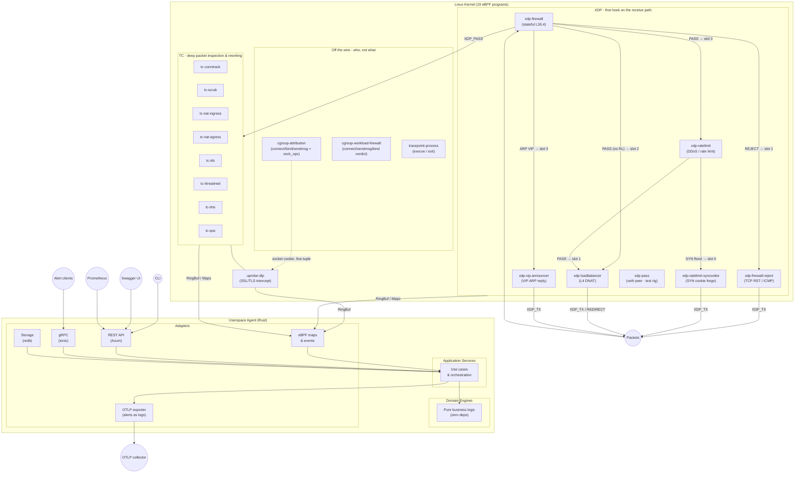

# eBPFsentinel

<p align="center">
  
</p>

A unified, kernel-native **Network & Security platform** for Linux - one Rust agent that replaces your firewall, IDS/IPS, DDoS mitigation, DLP, and 10+ more tools, all running in-kernel via eBPF at about a microsecond of kernel time per packet (see [benchmark results](tests/perf/BENCHMARK-RESULTS.md)). Not an endpoint agent - it enforces security inline, right where your traffic flows.

## Why eBPFsentinel

- **One agent, not a stack.** Firewall, IDS/IPS, DDoS, DLP, threat intel, NAT, and QoS normally mean a rack of appliances or a pile of daemons - each with its own config, parser, and packet copy. eBPFsentinel runs them as one agent sharing one kernel pipeline, beside a small privileged broker (the warden) that holds the few operations the kernel will not delegate: less to deploy, less to patch, less attack surface.
- **In-kernel, at the source.** Programs attach at XDP/TC/uprobe hook points, so traffic is inspected and dropped in the kernel - no packet copy to userspace on the fast path, no sidecar hop. Malicious traffic dies on the wire instead of costing you CPU upstack.
- **Network placement, not endpoint sprawl.** It runs where traffic flows - host NIC, node boundary - not as an agent on every workload. One enforcement point per node sees east-west and north-south alike, with no per-app instrumentation.
- **Built for trust.** Pure Rust with `#![forbid(unsafe_code)]` across the domain and application layers and a hexagonal/DDD design. The agent runs **rootless** via BPF token delegation - zero `CAP_BPF` / `CAP_NET_ADMIN` in the agent itself - and tags every alert with MITRE ATT&CK for your SIEM.

## What it does

A snapshot of the capabilities below - see the [Features guide](https://github.com/ebpfsentinel/ebpfsentinel-docs/tree/main/docs/features/overview.md) for the full reference on each engine.

### Network Security & Control

| Feature | Summary |
|---------|---------|
| **DDoS Mitigation** | XDP-speed SYN cookies + flood detection, drops attacks before the TCP stack |
| **Stateful Firewall** | L3/L4 filtering with conntrack, GeoIP, zones, VLAN/QinQ, IPv4/IPv6 |
| **L7 Filtering** | Protocol-aware rules for HTTP, TLS/SNI, gRPC, SMTP, FTP, SMB |
| **L4 Load Balancer** | TCP/UDP/TLS passthrough with four balancing algorithms |
| **Traffic Shaping (QoS)** | Bandwidth limits, fair queuing, EDT pacing, FQ-CoDel AQM |
| **Rate Limiting** | Four algorithms with kernel-side per-country tiers |
| **NAT** | SNAT, DNAT, masquerade, port forwarding, 1:1, NPTv6, hairpin |
| **Connection Tracking** | Kernel-side TCP/UDP/ICMP state machine with timeout policies |
| **Traffic Normalization** | TTL/MSS/flag scrubbing, IP ID randomization, DSCP rewriting |
| **Policy Routing** | Multi-gateway with health checks and automatic failover |
| **Zone Segmentation** | Network zones (DMZ/LAN/WAN) with inter-zone isolation |
| **Interface Groups** | Named NIC groups for multi-NIC rule scoping |
| **IP/Port Aliases** | Reusable named objects across firewall, IPS, and DDoS rules |
| **VLAN / QinQ** | 802.1Q and 802.1ad double-tagging across engines |
| **IPv6 Dual-Stack** | Full V4/V6 parity, NDP-aware, NPTv6 |

### Threat Detection & Response

| Feature | Summary |
|---------|---------|
| **IDS / IPS** | Kernel-side pattern matching with automatic blocking |
| **Threat Intelligence** | Any OSINT feed (CSV, JSON, STIX 2.1) with real-time IOC matching |
| **DLP** | TLS inspection for PCI, PII, and credential patterns via uprobe |
| **DNS Security** | Passive capture, blocklists, behavioral reputation scoring |
| **MITRE ATT&CK Mapping** | Every alert tagged with tactic + technique ID |
| **JA4+ Fingerprinting** | TLS client fingerprinting for C2 and malware detection |
| **GeoIP Enforcement** | MaxMind country resolution shared across all engines |
| **Automated Response** | Condition-based policies (block IP, webhook, escalation) |

### Operations

| Feature | Summary |
|---------|---------|
| **Hot Reload** | Update rules and toggle eBPF programs without restart |
| **REST API** | OpenAPI 3.0 with Swagger UI, all domains covered |
| **gRPC Streaming** | Real-time alert subscriptions with severity/component filters |
| **Prometheus Metrics** | Per-domain and kernel-side eBPF counters |
| **OTLP Export** | Alerts as OpenTelemetry Logs (gRPC or HTTP) |
| **Alert Pipeline** | Routing to email, webhook, log, OTLP with dedup + throttling |
| **Audit Trail** | Rule change history with before/after diff and actor tracking |
| **Packet Capture** | Ring-buffer capture with BPF filters for forensics |
| **CLI** | 18+ subcommands with `--output table\|json` and `--token` auth |
| **Authentication** | JWT, OIDC, and API keys with role-based access |
| **TLS 1.3** | rustls + aws_lc_rs, post-quantum ready (X25519MLKEM768) |

## Architecture

<p align="center">
  <picture>
    <source media="(prefers-color-scheme: dark)" srcset="./assets/ebpfsentinel-datapath-dark.svg">
    
  </picture>
</p>

<details>
<summary><b>Every program and every tail call</b></summary>



</details>

## Quick start

### See it work first, in one command

Before installing anything on a host you care about, run the lab. It builds a
network of its own on a bridge named `esdemo0`, touches no uplink of yours,
asks nothing of you and signs you up to nothing. It comes from the release,
like every other artifact:

```bash
curl -fsSLO https://github.com/ebpfsentinel/ebpfsentinel-release/releases/latest/download/ebpfsentinel-demo.tar.gz
tar xzf ebpfsentinel-demo.tar.gz && cd ebpfsentinel-demo
sudo ./demo.sh up
sudo ./demo.sh agent status
sudo ./demo.sh down
```

The lab is pinned to the release it was downloaded with, and its checksum and
signature are in that release's `SHA256SUMS`. From a checkout of this
repository the same lab is `demo/`, and `sudo ./demo.sh up --local` builds the
agent from your working tree instead of pulling the published image.

What it shows, with the commands in the
[tutorials](https://github.com/ebpfsentinel/ebpfsentinel-docs/tree/main/docs/tutorials):
a SYN flood stopped and its source blocked, a card number caught inside TLS
without a proxy and without a key, and a workload cut off for calling an AI
provider. `demo/gitops/gitops.sh up` runs the same agent as a fleet driven by
Argo CD, where a rule arrives through a commit and leaves through a revert.
Details, host requirements and the lab's own addresses are in
[`demo/README.md`](demo/README.md).

### Install for real

**Requirements:** Linux kernel 6.9+ on x86_64 or aarch64, with BTF (`CONFIG_DEBUG_INFO_BTF=y`). The 6.9 floor unlocks **BPF token delegation** - the agent loads its eBPF programs with zero `CAP_BPF` / `CAP_NET_ADMIN` (rootless).

### Install (prebuilt)

Grab the latest tarball for your architecture from the
[releases page](https://github.com/ebpfsentinel/ebpfsentinel-release/releases) -
every component is released together from there, so the release you download
also tells you which operator and dashboard versions it was tested with. The
tarball ships the agent, prebuilt eBPF objects, a systemd unit, and an
`install.sh`:

```bash
tar xzf ebpfsentinel-<version>-linux-amd64.tar.gz
cd ebpfsentinel-<version>-linux-amd64
sudo ./install.sh            # installs to /usr/local, wires up the systemd unit
```

Each release carries a dual-signed inventory of every binary hash and image
digest; verify before installing with `policy/verify.sh` from the same release.

### Build from source

The userspace agent builds on **stable**; the eBPF kernel programs need a **nightly** toolchain, pinned to a date in `crates/ebpf-programs/rust-toolchain.toml` and passed to cargo by `cargo xtask` (`bpfel` target). Install Rust via [rustup](https://rustup.rs):

```bash
cargo build --release        # agent + warden broker (stable)
cargo xtask ebpf-build        # eBPF programs (the pinned nightly)

# eBPF loads only through a BPF token (a user-namespace feature). The privileged
# `warden` broker (bpffs delegation, conntrack, routes, ARP, pcap) runs alongside
# the agent, which self-unshares a user namespace and loads its own eBPF through
# the token - never CAP_BPF. Start the broker, then the agent:
sudo ./target/release/warden serve /run/ebpfsentinel/warden.sock --uid 0 &
sudo EBPFSENTINEL_WARDEN_SOCK=/run/ebpfsentinel/warden.sock \
  ./target/release/ebpfsentinel-agent --config config/ebpfsentinel.yaml
```

The systemd install (`dist/install.sh`) wires this as two units - `ebpfsentinel-warden.service` (broker) + `ebpfsentinel.service` (agent) - mirroring the Docker split.

### Docker (rootless)

The agent loads eBPF **exclusively** through a BPF token (kernel 6.9+) - never `CAP_BPF`, never `--privileged`. The deployment is two containers: the privileged `warden` broker and the rootless `agent`, sharing a control socket. `docker compose up` wires both:

```bash
# The agent runs as uid 65534 and rejects a world-readable config; make it
# readable by that uid:
#   sudo chown 65534:65534 config/ebpfsentinel.yaml && sudo chmod 640 config/ebpfsentinel.yaml
docker compose up -d        # starts the warden broker + the agent
docker compose logs -f
```

The capabilities are held by the `warden` broker (bpffs delegation, conntrack/routes, the pcap pool + ARP); the agent drops every capability - it self-unshares a user namespace and loads its own eBPF through the token. See the [BPF token guide](https://github.com/ebpfsentinel/ebpfsentinel-docs/tree/main/docs/operations/deployment/bpf-token.md) for the systemd and Kubernetes paths and the full capability matrix.

### Minimal config

Only the interface is required:

```yaml
agent:
  interfaces: [eth0]
```

### Verify it's running

```bash
curl http://127.0.0.1:8080/healthz     # liveness probe, answers without a key
# Every other route authenticates. With no method configured, the agent drew a
# key at first start, printed it once and kept it:
export EBPFSENTINEL_TOKEN=$(sudo cat /var/lib/ebpfsentinel/auth/api-key)
ebpfsentinel-agent status              # agent + per-engine status, reads the variable
curl -H "X-API-Key: $EBPFSENTINEL_TOKEN" http://127.0.0.1:8080/api/v1/firewall/rules
```

The control plane is shut by default: it authenticates, and it stays on
loopback unless TLS is configured. Both are one setting away from being opened
deliberately, and neither can be opened by accident.

See the [Getting Started guide](https://github.com/ebpfsentinel/ebpfsentinel-docs/tree/main/docs/getting-started/quickstart.md) for detailed setup instructions.

## Documentation

Full documentation is available at [ebpfsentinel/ebpfsentinel-docs](https://github.com/ebpfsentinel/ebpfsentinel-docs):

| Section | Description |
| ------- | ----------- |
| [Getting Started](https://github.com/ebpfsentinel/ebpfsentinel-docs/tree/main/docs/getting-started/quickstart.md) | Installation, prerequisites, first run |
| [Features](https://github.com/ebpfsentinel/ebpfsentinel-docs/tree/main/docs/features/overview.md) | Detailed feature guides (firewall, IDS, DLP, ...) |
| [Configuration](https://github.com/ebpfsentinel/ebpfsentinel-docs/tree/main/docs/configuration/overview.md) | YAML reference for all sections |
| [Architecture](https://github.com/ebpfsentinel/ebpfsentinel-docs/tree/main/docs/architecture/overview.md) | Hexagonal/DDD design, eBPF pipeline, data flow |
| [Kernel Reference](https://github.com/ebpfsentinel/ebpfsentinel-docs/tree/main/docs/kernel/overview.md) | eBPF programs, maps, helpers, pipeline |
| [Hot Reload](https://github.com/ebpfsentinel/ebpfsentinel-docs/tree/main/docs/operations/hot-reload.md) | Dynamic eBPF program loading/unloading |
| [REST API](https://github.com/ebpfsentinel/ebpfsentinel-docs/tree/main/docs/api-reference/rest-api.md) | All endpoints with request/response formats |
| [gRPC API](https://github.com/ebpfsentinel/ebpfsentinel-docs/tree/main/docs/api-reference/grpc-api.md) | Alert streaming service |
| [CLI Reference](https://github.com/ebpfsentinel/ebpfsentinel-docs/tree/main/docs/cli-reference/index.md) | All commands and options |
| [Prometheus Metrics](https://github.com/ebpfsentinel/ebpfsentinel-docs/tree/main/docs/api-reference/prometheus-metrics.md) | Metric names and labels |
| [Deployment](https://github.com/ebpfsentinel/ebpfsentinel-docs/tree/main/docs/operations/deployment/docker.md) | Docker, Kubernetes, binary |
| [Security](https://github.com/ebpfsentinel/ebpfsentinel-docs/tree/main/docs/architecture/security-model.md) | TLS, auth, hardening |
| [Development](https://github.com/ebpfsentinel/ebpfsentinel-docs/tree/main/docs/development/building.md) | Building, testing, contributing |
| [Examples](https://github.com/ebpfsentinel/ebpfsentinel-docs/tree/main/docs/examples/index.md) | Real-world deployment scenarios |

Per-feature configuration examples are in [`config/examples/`](config/examples/).

The changelog is kept with the releases rather than here, so the whole product's history reads in one place: [`ebpfsentinel-release/changelogs/ebpfsentinel.md`](https://github.com/ebpfsentinel/ebpfsentinel-release/blob/main/changelogs/ebpfsentinel.md).

## Compatibility

- **OS:** Linux only (kernel 6.9+ with BTF)
- **Distros:** Debian 13+, Ubuntu 24.04.2+ with the HWE kernel, RHEL / Rocky 10+, Fedora 41+, Alpine 3.21+, Arch, NixOS with `linuxPackages_latest`, Talos 1.9+. Not Debian 12 (6.1), Ubuntu 22.04 (HWE stops at 6.8), Ubuntu 24.04 on its GA kernel (6.8), RHEL 9 (5.14) or Alpine 3.20 (6.6) without a newer kernel
- **Arch:** x86_64 and aarch64, the userspace tests run on both in CI
- **Runtime:** Docker, Podman, Kubernetes (DaemonSet), Nomad

See [Compatibility](https://github.com/ebpfsentinel/ebpfsentinel-docs/tree/main/docs/operations/compatibility.md) for the full matrix.

## OSS vs Enterprise

The **open-source agent** is fully functional on its own: every security domain shown above, plus the REST/gRPC APIs, CLI, authentication, and observability. Nothing in the core is paywalled.

The **enterprise edition** layers on capabilities for fleets and regulated environments:

| Area | Enterprise adds |
| ---- | --------------- |
| Detection | ML anomaly detection (Z-score, EWMA, CUSUM, ONNX, heavy-hitter CMS, DGA/tunneling, C2 beaconing, TLS clustering), AI/LLM security, TLS intelligence, network forensics |
| L7 deep inspection | Extended protocol parsers (MQTT, AMQP, NATS, Cassandra), content inspection (SQLi/XSS/injection signatures), per-protocol policies (Redis/Mongo/Kafka/SQL/LDAP/SSH), alert enrichment (OWASP/MITRE/PCI), extended TLS-library hooking |
| Data protection | Advanced DLP (Vectorscan engine, custom patterns, block mode) |
| Operations | HA clustering, multi-cluster federation, fleet management, air-gap mode |
| Multi-tenancy & access | Multi-tenancy (isolation + quotas), advanced RBAC, advanced analytics & reports |
| Integration & response | SIEM integration (10 connectors), automated response orchestration (SOAR) |
| Compliance | Compliance reports (PCI-DSS 4, HIPAA, GDPR, SOC 2, NIS2, DORA, SecNumCloud, HDS) |
| Licensing & integrity | Ed25519 + ML-DSA-65 dual-signed keys, machine fingerprint binding, air-gap activation, SHA-256 + Ed25519 binary self-verification at startup |
| Kubernetes operator | CRD-driven deployment & lifecycle management for the agent fleet |
| Web dashboard | Multi-tenant web UI & control plane (MSSP front-end) |

See [Enterprise Features](https://github.com/ebpfsentinel/ebpfsentinel-docs/tree/main/docs/features/enterprise/overview.md) for the full list and per-feature detail.

## License

GNU Affero General Public License v3.0 - see [LICENSE](LICENSE).
